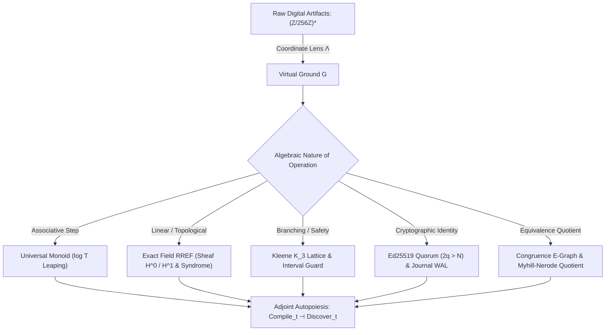

# The Throughline: Philosophy, Intuition & Mathematical Lineage of $\mu\text{VLD-64}$

---

## 1. The Core Question & Foundational Thesis

Across fifty years of computer engineering, computation has been conflated with physical hardware: a program is executed by a specific central processor, tied to a concrete physical host, reading from addressable local DRAM, and bound to proprietary device instruction sets.

**Virtual Layer Dynamics (`vld`)** begins with an inversion of this premise:

> **The physical processor is a disposable realizer of computation, not the definition of the computation.**
>
> *Can communication paths, sensors, queues, services, and hosts—anything capable of receiving, transforming, and communicating information—form a connected computational fabric that operates virtual machines, processes, and dynamical systems more effectively than dedicated physical machines?*

`μVLD-64` is the consolidated, micro-kernel realization of four predecessor research programmes, distilling $1.81\text{ MiB}$ of research source code into a clean, unified **64 KiB** algebraic foundation.

```
       [ E-CPU (mailcpu) ]                   [ Virtual Ground Interpreter (vgi) ]
   Receiver-owned Hypervisor authority,        Signal-state phasor execution (Z/8Z),
   Structural Memory, content-addressed        Three-valued Kleene K_3 truth guards,
   M1 byte objects, Internet as a Computer.    Observer reframing & ProofGrounds.
              \                                             /
               \                                           /
                ---> [ Virtual Layer Dynamics (vld) ] <---
               /     Unified 8-Tuple Ground Framework     \
              /      Adjoint Autopoietic Dynamics (Compile ⊣ Discover)
             /                                             \
  [ E-CPU Virtual Processor (vp) ]              [ In-Formation-Space (ifs) ]
  Persistent logical processor identity,        Epistemic classification triad,
  Hash-chained journals on disposable hosts,    Constructive neural synthesis (SNC/PNF),
  Dual-derivation affine orbit leaping.         Safetensors 206 glancing & subagents.
                                   |
                                   v
                         [ μVLD-64 Runtime ]
              Universal Algebraic Micro-Kernel (<= 64 KiB)
```

---

## 2. Lineage of the Four Predecessor Programmes

### Lineage 1: E-CPU (`mailcpu`) — Computational Grounds & Structural Memory
* **The Insight:** Any arbitrary data stream is natively an element of the product ring $(\mathbb{Z}/256\mathbb{Z})^N$. Raw bytes carry exact content identity via cryptographic hashing ($h = \operatorname{SHA256}(x)$), but meaning is conferred only through an explicit, declared **coordinate lens** $\Lambda$.
* **The Lens Equation:**
  $$\Lambda = (\operatorname{lift}: (\mathbb{Z}/256\mathbb{Z})^* \to \Sigma, \quad \operatorname{lower}: \Sigma \to (\mathbb{Z}/256\mathbb{Z})^*)$$
  $$\forall x \in \mathcal{D}_\Lambda, \quad \operatorname{lower}(\operatorname{lift}(x)) \equiv x$$
* **Receiver-Owned Authority:** Authority remains strictly receiver-local. Transport reachability never implies execution authority, and receiving a message never implies committing a state change.
* **The Internet as a Computer:** Network hops and existing distributed services (e.g., Git Smart HTTP servers, caching proxies, kernel packet filters) are modeled as **observer-hosts**. A Git server computing a set-difference over a commit DAG via `want`/`have` pkt-lines is computing set-difference natively without running an arbitrary VM worker.

### Lineage 2: Virtual Ground Interpreter (`vgi`) — Signal Computation & Kleene Uncertainty
* **The Insight:** Computation does not require discrete binary registers. In signal-valued domains (such as cyclic phase $\mathbb{Z}/M\mathbb{Z}$, instantiated for $M=8$), symbols are characters on the unit circle:
  $$\chi_u(k) = \exp\!\left(\frac{2\pi i u k}{M}\right), \quad u \in (\mathbb{Z}/M\mathbb{Z})^\times$$
* **Observer Reframing:** Transitioning between observer vantage points $u \to v$ is an endomorphism raising the phasor to power $m = v u^{-1} \bmod M$:
  $$R_{u \to v}(\chi_u(k)) = \chi_v(k)$$
* **Trapping Instead of Guessing:** Under noisy or partial observations $[L, U] = [\max(0, d - e), \min(\pi, d + e)]$, truth values inhabit the bounded distributive Kleene algebra $\mathcal{K}_3 = (\{\text{FALSE}, \text{INDETERMINATE}, \text{TRUE}\}, \land, \lor, \lnot)$:
  $$a \land b = \min(a, b), \quad a \lor b = \max(a, b), \quad \lnot a = 2 - a$$
  Any branch encountering `INDETERMINATE` traps atomically, leaving system state unmutated.

### Lineage 3: E-CPU Virtual Processor (`vp`) — Continuity Across Disposable Hosts
* **The Insight:** A processor is not the physical machine executing it. A GitHub Actions runner, a cloud VM, or a serverless worker is merely an ephemeral observer-host that restores processor state, navigates a Ground transition, appends a verified receipt, and is terminated.
* **Dual-Derivation Orbit Leaping:** For affine dynamics $x_{t+1} = (a x_t + b) \bmod m$, advancing $T$ coordinates step-by-step requires $\Theta(T)$ time. Binary exponentiation in the affine transformation monoid evaluates $T$ steps in $O(\log T)$ time:
  $$(a_2, b_2) \circ (a_1, b_1) = \big(a_2 a_1 \bmod m, \; (a_2 b_1 + b_2) \bmod m\big)$$
  To ensure soundness against implementation defects, the virtual processor verifies this against homogeneous $2 \times 2$ matrix exponentiation over $(\mathbb{Z}/m\mathbb{Z})^{2 \times 2}$:
  $$\begin{pmatrix} x_T \\ 1 \end{pmatrix} \equiv \begin{pmatrix} a & b \\ 0 & 1 \end{pmatrix}^T \begin{pmatrix} x_0 \\ 1 \end{pmatrix} \pmod m$$
* **Wrap Identifiability Law:** Fitting parameters to finite observations does not confer a law unless degrees of freedom satisfy $df \ge 1$. An unwrapped additive sequence without a witnessed modular wrap represents an uncalibrated hypothesis (`HYPOTHESIS`), refusing premature certification.

### Lineage 4: In-Formation-Space (`ifs`) — Epistemic Dynamics & Constructive Neural Morphisms
* **The Lightweight Epistemic Vocabulary:**
  1. *Observation:* Directly measured phenomenon with provenance.
  2. *Inference:* Inspectable reasoning derived from premises.
  3. *Hypothesis:* Possibility under active investigation.
  4. *Experiment:* Bounded test designed to falsify competing claims.
  5. *Verified:* Checked against an explicit mathematical contract.
  6. *Unknown / Ambiguous:* Evidence is insufficient; state is explicitly preserved rather than guessed.
* **Constructive Neural Synthesis (SNC):** Continuous piecewise-affine laws compile constructively (with zero gradient descent) into exact rational ReLU networks.
* **The Flash-Stream Attention Monoid:** Computing multi-shard transformer attention across distributed paths forms an exact commutative monoid:
  $$(m_A, \ell_A, O_A) \otimes (m_B, \ell_B, O_B) = \left(\max(m_A, m_B), \; e^{m_A - m_{AB}}\ell_A + e^{m_B - m_{AB}}\ell_B, \; e^{m_A - m_{AB}}O_A + e^{m_B - m_{AB}}O_B\right)$$
  allowing attention to be accumulated in transit and normalized ($O / \ell$) solely at the terminal receiver.

---

## 3. The Grand Mathematical Synthesis in $\mu\text{VLD-64}$

`μVLD-64` unifies these lineages into five exact algebraic structures:



### 1. The Eight-Tuple Virtual Ground
Every computational space in $\mu\text{VLD-64}$ is formalized as:
$$\mathcal{G} = (\mathcal{L}, \Sigma_{\mathcal{G}}, \Delta_{\mathcal{G}}, \mathcal{I}_{\mathcal{G}}, \mathcal{O}_{\mathcal{G}}, \mathcal{C}_{\mathcal{G}}, \mathcal{E}_{\mathcal{G}}, \nu_{\mathcal{G}})$$
where $\mathcal{L}$ is the operator grammar, $\Sigma_{\mathcal{G}}$ the state space, $\Delta_{\mathcal{G}}$ admitted transitions, $\mathcal{I}_{\mathcal{G}}$ invariant predicates, $\mathcal{O}_{\mathcal{G}}$ observer projections, $\mathcal{C}_{\mathcal{G}}$ Pareto cost vectors, $\mathcal{E}_{\mathcal{G}}$ witness certificates, and $\nu_{\mathcal{G}}$ the schema fingerprint.

### 2. Multi-Objective Pareto Dominance
For any requested computation, candidate realizations carry a cost vector $\mathbf{C} = (L, E, B, R) \in \mathbb{R}_{\ge 0}^4$ measuring latency, compute operations, byte movement, and verification/recovery overhead. Realization $r_1$ Pareto-dominates $r_2$ ($\mathbf{C}(r_1) \prec \mathbf{C}(r_2)$) iff:
$$\forall i \in \{1..4\}, \; C_i(r_1) \le C_i(r_2) \quad \land \quad \exists j \in \{1..4\}, \; C_j(r_1) < C_j(r_2)$$

### 3. Cellular Sheaf Cohomology & Active Fault Isolation
Distributed observers $v \in V$ connected by measurement edges $e = (u, v) \in E$ form a cellular sheaf $\mathcal{F}$. Consistency across loops is governed by the 0-coboundary map $\delta^0: C^0(G; \mathcal{F}) \to C^1(G; \mathcal{F})$:
- When the measurement cocycle $c \in \operatorname{im}(\delta^0)$, an exact global section $x^* \in H^0(G; \mathcal{F})$ exists.
- When $c \notin \operatorname{im}(\delta^0)$, the Fredholm alternative guarantees a dual 1-cocycle $y \in \ker((\delta^0)^\top)$ witnessing obstruction:
  $$(\delta^0)^\top y = \mathbf{0} \quad \land \quad \langle y, c \rangle \neq 0$$
- In $\mu\text{VLD-64}$, active cohomological repair isolates faulty observers via minimum-support syndrome decoding:
  $$\hat{e}_{\text{fault}} = \arg\min_{e} \|e\|_0 \quad \text{subject to} \quad Y e = Y c$$

### 4. The Autopoietic Adjoint Pair ($\operatorname{Compile}_t \dashv \operatorname{Discover}_t$)
System evolution is governed by an adjoint relationship:
$$\operatorname{Compile}_t : \mathbf{Intent} \longrightarrow \mathcal{R}_t \qquad \dashv \qquad \operatorname{Discover}_t : (\mathcal{R}_t \times \mathbf{Residual}_t) \longrightarrow \mathcal{R}_{t+1}$$
Whenever a realization incurs excessive curvature residual:
$$\rho(\mathcal{I}) = \frac{\mathbf{C}_{\text{realized}}(\mathcal{I})}{\mathbf{C}_{\text{lower\_bound}}(\mathcal{I})} > \tau$$
an opportunity record is emitted, synthesizing M1 low-rank delta morphisms ($W' = W + \frac{\alpha}{r} A B^\top$) or discovering e-graph rewrite rules without mutating base model weights. This guarantees monotonic Pareto progress:
$$\mathcal{R}_t \subseteq \mathcal{R}_{t+1} \implies \min_{r \in \mathcal{R}_{t+1}} \mathbf{C}(r) \preceq_{\text{Pareto}} \min_{r \in \mathcal{R}_t} \mathbf{C}(r)$$

---

## 4. Why 64 KiB Matters

Compressing Virtual Layer Dynamics into $52.8\text{ KiB}$ is not a cosmetic reduction; it is an algorithmic proof of the central thesis:

$$\text{If a system claims computation can be lifted into a representation where structure eliminates redundant work,}$$
$$\text{then the implementation of that system must itself admit an algebraic representation that eliminates redundant code.}$$

By replacing thousands of lines of procedural boilerplate with universal mathematical kernels (Edwards curve arithmetic, exact field RREF, monoid composition, Kleene lattices, congruence e-graphs), `μVLD-64` achieves:
1. **Mathematical Auditability:** Every single function in the codebase corresponds directly to a proven theorem.
2. **Zero Dependencies:** Pure standard Python 3.11+ running identically on any operating system.
3. **Open for Iteration:** Adding a new Ground or operator requires only writing a compact algebraic combinator rather than deep framework scaffolding.
